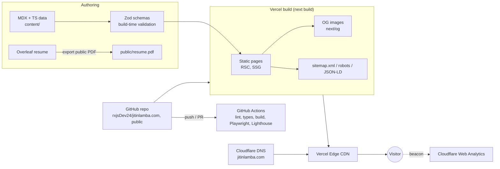

# jitinlamba.com Architecture (v0.2)

Personal portfolio for Jitin Lamba. Senior Software Engineer, frontend-focused, now working full stack on AI products.
Status: v0.2, written 17 Nov 2026 after three planning rounds. All v0.1 open decisions are settled or deliberately deferred (§10).

---

## 1. Goals and non-goals

**Primary goal.** A recruiter or hiring manager can scan the site in 30 seconds, then contact Jitin or download his resume.
Target roles are Senior/Lead Frontend, Full-Stack, AI-product, and Forward Deployed Engineer.

**Secondary goals**

- Be memorable through travel (a link to @ludic.lens).
- Show learning in public: skills he has proven versus skills he is learning now.
- Make the site and its public repo proof of frontend skill: performance, accessibility, code quality.

**Non-goals for v1.** A CMS, user accounts, comments, a weekly blog, a live Instagram feed, a separate travel brand site, a contact form, a light theme, and trip photo galleries.

**Quality bar (enforced in CI)**

- Lighthouse 95 or higher in all four categories on mobile.
- LCP under 1.5 s and CLS under 0.05 on the home page.
- WCAG 2.2 AA, including text contrast for the neon green on black. Full keyboard navigation. `prefers-reduced-motion` respected.
- First-load JS under 100 kB gzipped on content pages.

---

## 2. Principles

1. **Static by default.** Every page is pre-rendered at build time. Nothing is computed per request in v1.
2. **Content is typed data.** Skills, experience, case studies, and trips are validated at build. Invalid content fails the build.
3. **Honesty is encoded in the data.** Each skill has a `tier`. Each learning entry has a date. The UI cannot claim more than the data says. No metric appears unless Jitin supplied it.
4. **Low maintenance.** No weekly obligations. Old content shows its own date, so a gap never looks like abandonment.
5. **Pages are Server Components.** Client JS is only for interactive islands. In v1 that is the globe, and later the gallery lightbox.
6. **CSS-only motion.** The cobe globe is the only JS-driven animation.

---

## 3. Visual direction

- Editorial and minimal. Large type, generous whitespace, one column of reading where possible.
- Dark only. Black background, white text, neon green as the single accent.
- Neon green is used for motion and small accents (hero caret, link and card hover states, globe pins, tier indicators). It is never the only carrier of meaning.
- Under `prefers-reduced-motion`, everything is static and the green stays as a plain accent.
- Motion vocabulary, all CSS in `app/globals.css` with no JavaScript: hero letters rise on load, a scroll progress bar, `.reveal` wipes sections up as they enter, `.draw` draws heading rules, the contact headline assembles from scattered letters as it scrolls in, and hover states on nav, skills, proof tiles and experience rows. Scroll-driven effects sit behind `@supports (animation-timeline: view())`, so browsers without it get the static page. Reveals use `clip-path`, not opacity, so text never renders at low contrast.
- Theme tokens live as CSS variables, so a light theme can be added later without rewriting components.
- Reference sites: beargrylls.com and abhishekjha.me. We keep their huge condensed uppercase headlines, small letter-spaced mono labels and a thin accent marquee of facts. We drop their photos, 3D and scroll effects.
- Type: Bebas Neue for display headings, Geist Sans for body, Geist Mono for labels. All self-hosted through `next/font`.
- The home page layout was first mocked in Google Stitch (slice 3). Only the layout and styling came from Stitch. All text comes from `content/`.

---

## 4. Stack

| Concern          | Choice                                                                                                   | Why                                                                                                                                                        |
| ---------------- | -------------------------------------------------------------------------------------------------------- | ---------------------------------------------------------------------------------------------------------------------------------------------------------- |
| Framework        | **Next.js (App Router), TypeScript strict**                                                              | His strongest stack. RSC with static rendering.                                                                                                            |
| Styling          | **Tailwind CSS v4** with CSS variables for tokens                                                        | He already uses it at Sprinklr.                                                                                                                            |
| Content          | **MDX + Zod frontmatter** via `content-collections`                                                      | Typed content, no CMS, version-controlled. Compatibility with the current Next.js version is checked at slice 2.                                           |
| Data (non-prose) | Typed TS files in `content/data/`                                                                        | Skills, experience, trips.                                                                                                                                 |
| Images (v1)      | Files in the repo through `next/image`                                                                   | v1 has only a headshot and OG images. The host for trip photos is deferred (§10).                                                                          |
| Globe            | **cobe** (about 5 kB WebGL) for the travel hero, with a static SVG fallback                              | Tiny and gracefully degrading.                                                                                                                             |
| Animation        | CSS only, apart from the globe                                                                           | Keeps the JS budget.                                                                                                                                       |
| OG images        | `next/og`                                                                                                | Shared links look right on LinkedIn.                                                                                                                       |
| Hosting          | **Vercel Hobby**                                                                                         | First-class Next.js, a preview per PR. Hobby terms restrict commercial use, so revisit if freelance work becomes real. Keep code free of Vercel-only APIs. |
| DNS              | **Cloudflare**, records set to DNS only (grey cloud)                                                     | See §9.                                                                                                                                                    |
| Analytics        | **Cloudflare Web Analytics**                                                                             | Free, cookieless, no consent banner.                                                                                                                       |
| Contact          | `mailto:` to `hello@jitinlamba.com` plus LinkedIn                                                        | No backend in v1.                                                                                                                                          |
| Package manager  | **pnpm**, Node LTS pinned in `.nvmrc` and CI                                                             | Reproducible installs.                                                                                                                                     |
| Quality          | ESLint, Prettier, `tsc --noEmit`, Vitest (content integrity), Playwright smoke tests, Lighthouse CI, axe | Runs on every PR.                                                                                                                                          |
| License          | MIT for code. All rights reserved for `content/` and images.                                             | Stated in the README.                                                                                                                                      |

---

## 5. System overview



---

## 6. Information architecture

```
/                      Home: hero, highlights, featured work, skills (tiered), travel teaser, contact
/work                  All case studies
/work/[slug]           Case study: problem, my role, approach, impact, stack
/experience            Timeline (Sprinklr, Spinny, Phenom People), linked to case studies
/now                   Learning log: what I'm learning, dated entries, small proofs
/travel                Globe with pins, plus a list of trips (v1: pins only)
/travel/[slug]         Trip page (slice 6, first trip is London to Amsterdam/Brussels/Paris)
/resume                Resume page (HTML, from experience.ts) plus PDF download
/uses   (later)        Gear and tools (optional)
```

Home scroll order follows the recruiter's priorities. **Who and what, then proof, then skills, then personality (travel), then contact.**

Hero headline: "Frontend engineer who ships LLM products, growing into full stack." Hero includes a small headshot.

---

## 7. Content model

```ts
// content/schemas.ts is the single source of truth, validated with Zod at build

type SkillTier = "production" | "shipped" | "learning";
// production = used daily at work
// shipped    = has shipped real features (Java, Spring Boot, MongoDB at Sprinklr)
// learning   = actively learning, linked to /now entries

interface Skill {
  name: string;
  tier: SkillTier;
  category:
    | "frontend"
    | "backend"
    | "data"
    | "infra"
    | "ai"
    | "testing"
    | "architecture";
  evidence?: string[]; // slugs of case studies or log entries that prove it
  since?: string; // ISO date
}

interface Role {
  company: string;
  title: string;
  location: string;
  start: string;
  end?: string; // ISO; no end means current
  highlights: string[]; // taken from the resume; no invented claims
  caseStudies?: string[]; // slugs
}

interface CaseStudy {
  // MDX frontmatter
  slug: string;
  title: string;
  summary: string;
  role: string;
  period: string;
  impact: { label: string; value: string }[]; // may be empty; no metric without Jitin's number
  stack: string[]; // must match Skill.name
  featured: boolean;
  confidential?: boolean; // describe without internals
}

interface LogEntry {
  // /now, MDX
  date: string;
  topic: string; // must match a Skill with tier 'learning' or 'shipped'
  title: string;
  link?: string;
}

interface Trip {
  // /travel, MDX
  slug: string;
  title: string;
  places: { name: string; country: string; lat: number; lng: number }[];
  dates: { start: string; end: string };
  instagram?: string; // post URL on @ludic.lens
  // photos and cover are added in slice 6, after the image host is chosen
}
```

**Cross-reference checks at build.** Every `stack` item and log `topic` must exist in `skills`. Every `evidence` slug must exist. A broken reference fails the build.

**How it is enforced (slice 2).** The rules live in one pure module, `lib/integrity.ts`, and run in two places. The `work` and `now` collection transforms in `content-collections.ts` throw on a bad entry, which fails `next build`. A Vitest suite (`tests/content/`) also checks the real content, including the TS data files, and runs as `prebuild`, so `pnpm build` and the Vercel build fail on it too. Two rules go beyond the original list. A case study cannot list a `learning` skill in its `stack`, and a `now` entry cannot be about a `production` skill. `Trip` is not in the schema yet. It arrives in slice 6.

### Seed skills (from the resume and Jitin's answers)

- **production.** TypeScript, JavaScript, React, Next.js, Redux, RxJS, Apollo GraphQL, Tailwind CSS, Sass/SCSS, Jest, React Testing Library, Microfrontends, Core Web Vitals, LLM product development.
- **shipped.** Java, Spring Boot, MongoDB.
- **learning.** Node.js, Docker, Webpack, Kafka, Elasticsearch, Kubernetes.

The resume lists Node.js, Express, Docker and Webpack as "familiar with". They are treated as `learning` until Jitin says otherwise.

### First case study

LLM Insights is a public Sprinklr product for brand visibility in LLM-powered search. Jitin owned the report creation and management flow in the UI, and built supporting Java, Spring Boot and MongoDB features. The case study states only that scope. It carries no metric, because none was supplied. The resume line "built from scratch" is to be edited to match (§10).

---

## 8. Repository layout

```
jitinlamba.com/
├─ app/
│  ├─ (site)/page.tsx                 # home
│  ├─ work/[slug]/page.tsx
│  ├─ experience/page.tsx
│  ├─ now/page.tsx
│  ├─ travel/page.tsx
│  ├─ travel/[slug]/page.tsx
│  ├─ resume/page.tsx
│  ├─ og/[...slug]/route.tsx          # next/og
│  ├─ sitemap.ts  robots.ts  layout.tsx  not-found.tsx
├─ components/
│  ├─ ui/                             # primitives (Button, Tag, Card), server components
│  ├─ sections/                       # Hero, SkillsGrid, FeaturedWork, TravelTeaser, Contact
│  └─ islands/                        # 'use client' only: Globe (later Lightbox)
├─ content/
│  ├─ work/*.mdx  now/*.mdx  travel/*.mdx
│  ├─ data/skills.ts  data/experience.ts  data/site.ts
│  └─ schemas.ts
├─ lib/                               # content loaders, seo helpers
├─ public/resume.pdf  public/fonts/
├─ tests/e2e/*.spec.ts                # Playwright smoke and axe
├─ .github/workflows/ci.yml
├─ ARCHITECTURE.md  CLAUDE.md  README.md  LICENSE  .nvmrc
```

Rule: `components/islands/` is the only place `'use client'` may appear. An ESLint rule enforces this.

---

## 9. Hosting and DNS (Cloudflare to Vercel)

- Add `jitinlamba.com` and `www.jitinlamba.com` to the Vercel project.
- In Cloudflare DNS, add the apex `A` record and the `www` `CNAME` using the values **shown in the Vercel dashboard at that moment**. Do not copy an IP from this document.
- Set both records to **DNS only (grey cloud)** so Vercel handles TLS and caching. Proxying in front of Vercel causes double caching and certificate problems.
- Redirect `www` to the apex, in Vercel.
- Email. Set up Cloudflare Email Routing so `hello@jitinlamba.com` forwards to Gmail.
- Turn on Cloudflare Web Analytics by adding its JS snippet. It does not need proxying.
- The Cloudflare connector available to Claude has no DNS tools, so Jitin adds the records by hand. A checklist is written when slice 1 starts.
- The GitHub connector failed to authenticate. Repo creation uses the `gh` CLI, which Jitin installs and logs into (`brew install gh`, then `gh auth login`).

---

## 10. Decisions log and what is still open

**Settled in planning**

| #   | Decision                                                                                                            |
| --- | ------------------------------------------------------------------------------------------------------------------- |
| 1   | Image hosting is deferred until the first trip page. v1 serves repo images through `next/image`.                    |
| 2   | Visual direction: editorial minimal, dark only, neon green accent for motion.                                       |
| 3   | Case studies. LLM Insights first, described by Jitin's own scope. Employer internals stay out. No invented metrics. |
| 4   | Travel at launch is a globe with pins. Trip pages come in slice 6.                                                  |
| 5   | Overleaf is the PDF source. The `/resume` page renders from `experience.ts`.                                        |
| 6   | Contact is `mailto:` plus LinkedIn. No form.                                                                        |
| 7   | Dark mode: dark only. No toggle.                                                                                    |
| 8   | Hosting: Vercel with Cloudflare DNS.                                                                                |
| 9   | Home page proof tiles: 6 yrs, 30% and 20% (Spinny), LLM product (Sprinklr). Proof lives in `content/data/proof.ts`. |
| 10  | No resume download until the phone-free export exists. `Common.pdf` is never served.                                |

**Adopted recommendations that Jitin should still sanity-check**

- Public `resume.pdf` omits the phone number and uses `hello@jitinlamba.com`. Jitin keeps the full resume for applications. This needs a second Overleaf export.
- The resume line "Built a brand-intelligence product from scratch" should be edited to match the case study's scope, so the two claims agree.
- Node.js, Express, Docker and Webpack sit in `learning`. Move any he has shipped with.

**Still open**

- Headshot file.
- Exact LinkedIn URL for the contact section. The resume gives `linkedin.com/in/lamba-jitin`.
- Real numbers for the LLM Insights case study, if any exist.
- Image host for trip photos (Cloudinary, R2, or repo). Decide in slice 6.

---

## 11. Delivery plan (v1 in about 2 weeks of evenings)

| #   | Slice (each one ends deployed)                                                        | Done when                                                        |
| --- | ------------------------------------------------------------------------------------- | ---------------------------------------------------------------- |
| 1   | Scaffold Next, TS, Tailwind, CI. Create the repo. Deploy to Vercel. DNS live.         | `jitinlamba.com` serves a placeholder over HTTPS and CI is green |
| 2   | Content layer, schemas, skills and experience data                                    | The build fails on a bad reference                               |
| 3   | Home page: hero, highlights, skill tiers, contact, public resume PDF                  | Lighthouse 95 or higher. A recruiter can contact you.            |
| 4   | Work: LLM Insights case study first, then one more                                    | Pages render. Employer work is described safely.                 |
| 5   | `/now` learning log, seeded with 3 to 5 entries (Docker, Kafka, Kubernetes and so on) | Linked from skills with tier `learning`                          |
| 6   | Travel: globe island, first trip page, gallery. Choose the image host here.           | Globe lazy-loads. The reduced-motion fallback works.             |
| 7   | SEO polish: OG images, JSON-LD `Person`, sitemap, accessibility audit                 | A shared link looks right on LinkedIn                            |

**Launch after slice 3.** Everything after that is additive.
